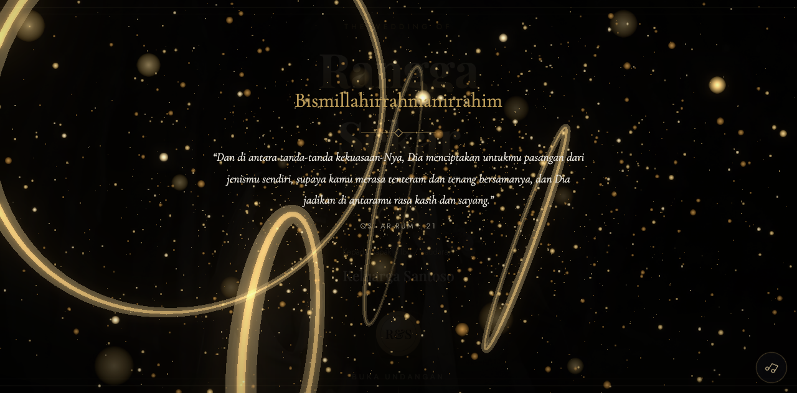

# Undangan Pernikahan Digital 2D Elegan - Gratis, Open Source

**Segel interaktif - Galeri foto - Countdown - Amplop digital QRIS - Nama tamu otomatis**

Satu file HTML tanpa framework, tanpa build step. Kloning, ganti data, terbit.

[Demo Live](https://undangan-3d.pages.dev/demo/?to=Nama%20Tamu) - [Versi 3D Sinematik](https://github.com/arapcihuy/undangan-digital-3d)

---

## Isi undangan

- Pembuka interaktif dengan segel lilin dan nama mempelai
- Countdown menuju hari-H
- Profil mempelai dan cerita cinta
- Detail acara: akad, resepsi, dress code, rundown
- Galeri foto dengan lightbox
- Amplop digital: nomor rekening + QRIS
- RSVP dan buku tamu
- Nama tamu otomatis lewat parameter `?to=Nama%20Tamu`
- Responsif penuh: HP, tablet, desktop
- Tanpa jQuery, tanpa framework, ~40KB

## Cara pakai

1. Kloning atau unduh repo ini
2. Edit `template/index.html`: nama, tanggal, lokasi, rekening, QRIS
3. Ganti foto di `template/assets/`
4. Host gratis: drag & drop folder ke [Cloudflare Pages](https://pages.cloudflare.com) atau Netlify
5. Sebar link ke tamu

Versi gratis ini memakai tampilan 2D elegan. Butuh efek partikel WebGL bercahaya,
bloom sinematik, dan kamera 3D yang mengikuti sentuhan? Lihat
[versi 3D sinematik](https://github.com/arapcihuy/undangan-digital-3d) -
bisa juga dipesan jadi mulai Rp 99 ribu lewat
[WhatsApp](https://wa.me/6281387906930).

## Lisensi

Bebas dipakai dan dimodifikasi untuk proyek pribadi maupun klien.
Foto demo dari Unsplash (bebas lisensi).
